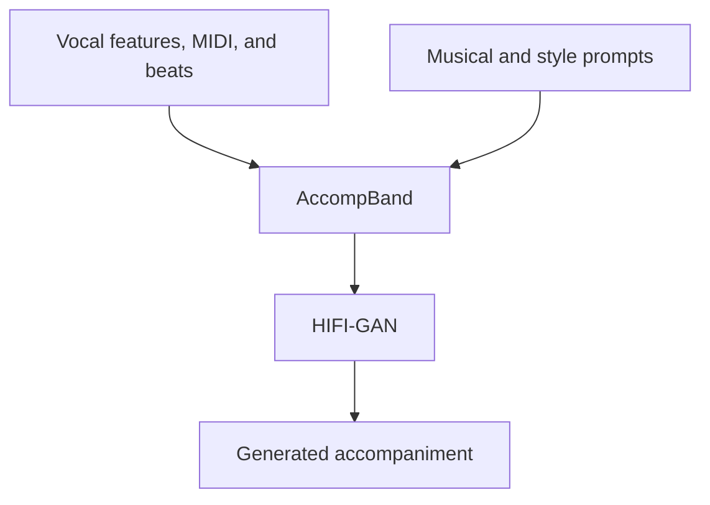

<div align="center">

# VersBand

**Versatile song generation with prompt-based control**

[EMNLP 2025](https://arxiv.org/abs/2504.19062)

[](https://arxiv.org/abs/2504.19062) [](https://aaronz345.github.io/VersBandDemo/) [](https://github.com/AaronZ345/VersBand)

[Quick start](#quick-start) · [Model assets](#model-assets) · [Input format](#input-format) · [Training](docs/training.md) · [Citation](#citations)

</div>

VersBand combines vocal and accompaniment generation with prompt-based control. **This repository contains AccompBand**, the accompaniment model's preprocessing, training, and inference code. Prepare your trained model checkpoint before running generation.

| Implementation | Requirements |
| --- | --- |
| Included model | AccompBand; VocalBand code is not included here |
| Conditioning | Vocal features, MIDI, beats, and text prompts |
| Output | 24 kHz accompaniment and mixed-song WAV files |
| Runtime | Python 3.10, PyTorch 2.1.0 + CUDA 12.1 |



## Quick start

### 1. Install the environment

```bash
git clone https://github.com/AaronZ345/VersBand.git
cd VersBand
conda create -n versband python=3.10 -y
conda activate versband
python -m pip install -r requirements.txt \
  --find-links https://download.pytorch.org/whl/torch_stable.html
```

### 2. Prepare model assets and input

The [training guide](docs/training.md) covers your song dataset, vocal/accompaniment separation, MIDI and beat annotations, captions, mel preprocessing, VAE training, and AccompBand training. Update the scripts and configuration paths to your data.

For inference, provide the trained model, its matching configuration, a processed TSV manifest, and the MIDI/beat condition files. Update the `HifiGAN(vocoder_ckpt=...)` path in [gen_song](scripts/test_final.py) to your downloaded 24 kHz vocoder; the current example path is specific to the original development machine.

### 3. Run accompaniment inference

```bash
PYTHONPATH=. CUDA_VISIBLE_DEVICES=0 python scripts/test_final.py \
  --config configs/vocal2music.yaml --ckpt /path/to/your/model.ckpt \
  --manifest_path /path/to/your/manifest.tsv \
  --other_condition /path/to/your/midi.npy --save_dir infer_out
```

The matching beat file is resolved by replacing `midi` with `beats` in the condition path. Use a path pair such as `midi.npy` and `beats.npy`, and keep all item keys aligned. The script writes generated accompaniment, mixed-song, and reference WAV files, plus a `clap.csv` index under `--save_dir`. Guidance scales are controlled by `--scales`.

## Model assets

| Asset | Preparation |
| --- | --- |
| Accompaniment VAE | Train with [configs/ae_accomp.yaml](configs/ae_accomp.yaml) |
| AccompBand model | Train with [configs/vocal2music.yaml](configs/vocal2music.yaml) |
| HIFI-GAN | [Download](https://drive.google.com/drive/folders/19DHgcdDHl0WOLulTtpSHPg9h7B7m-b_B?usp=drive_link) to `useful_ckpts/hifigan`; set the inference vocoder path |
| FLAN-T5 | [Hugging Face](https://huggingface.co/google/flan-t5-large) to `useful_ckpts/flan-t5-large` |

## Input format

The inference manifest uses `name`, `audio_path`, `mel_path`, `vocal_mel_path`, `duration`, `caption`, and musical metadata such as key, tempo, and emotion. MIDI and beat files map these item names to aligned condition arrays. See [scripts/test_final.py](scripts/test_final.py) and the [training guide](docs/training.md) for the complete field usage.

Inference processes every eligible row (duration up to 20 seconds), including single-row manifests and repeated names. Use `--sample-limit 10 --sample-seed 0` for a reproducible subset; the seed controls row selection. Multi-GPU inference uses disjoint rows and per-rank CSVs, then combines `clap.csv` in source `manifest_index` order. Beat/MIDI padding uses the training sentinels 2/128.

## Method and training

The full VersBand framework includes VocalBand for vocal synthesis and AccompBand for accompaniment. AccompBand uses a flow-based transformer and Band-MOE for accompaniment quality, alignment, and control. The [paper](https://arxiv.org/abs/2504.19062) describes both models and the song-generation comparisons; this repository releases the AccompBand implementation.

<details>
<summary>Release history and authors</summary>

- August 2025: released AccompBand code; VersBand accepted to EMNLP 2025.

Yu Zhang, Wenxiang Guo, Changhao Pan, Zhiyuan Zhu, Ruiqi Li, Jingyu Lu, Rongjie Huang, Ruiyuan Zhang, Zhiqing Hong, Ziyue Jiang, Zhou Zhao | Zhejiang University

[语音之家](https://mp.weixin.qq.com/s/fsbNdPyfEFi-_QHOCy85RQ) · [PaperWeekly](https://mp.weixin.qq.com/s/tIwnbBXqVEwlUKRwxPceSA) · [知乎](https://zhuanlan.zhihu.com/p/1943351555119097448)

</details>

## Acknowledgements

This implementation uses parts of the code from the following Github repos:
[Make-An-Audio-3](https://github.com/Text-to-Audio/Make-An-Audio-3),
[TCSinger2](https://github.com/AaronZ345/TCSinger2)
[Lumina-T2X](https://github.com/Alpha-VLLM/Lumina-T2X)
as described in our code.

## Citations ##

If you find this code useful in your research, please cite our work:
```bib
@article{zhang2025versatile,
  title={Versatile framework for song generation with prompt-based control},
  author={Zhang, Yu and Guo, Wenxiang and Pan, Changhao and Zhu, Zhiyuan and Li, Ruiqi and Lu, Jingyu and Huang, Rongjie and Zhang, Ruiyuan and Hong, Zhiqing and Jiang, Ziyue and others},
  journal={arXiv preprint arXiv:2504.19062},
  year={2025}
}
```

## Disclaimer ##

Any organization or individual is prohibited from using any technology mentioned in this paper to generate someone's songs without his/her consent, including but not limited to government leaders, political figures, and celebrities. If you do not comply with this item, you could be in violation of copyright laws.

